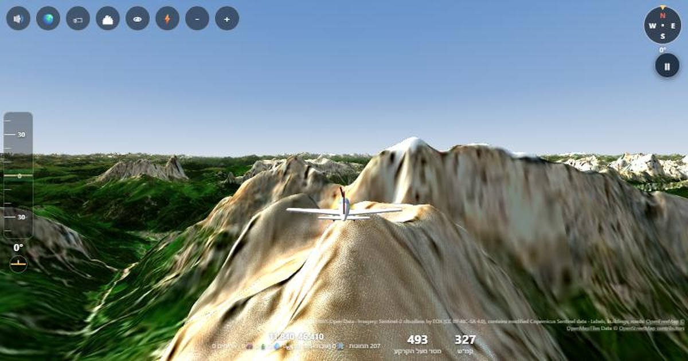

# טיסה סביב העולם (Flight World)

סימולטור טיסה בדפדפן מעל הנוף האמיתי של כדור הארץ: טופוגרפיה אמיתית, צילומי לוויין, בניינים, כבישים, עצים, מכוניות ומים – בכל מקום בעולם, בלי התקנה.
הדגש הוא על **נוף מציאותי ותחושת טיסה**, לא על מערכות מטוס מורכבות.

🌍 **לשחק:** https://flight-world.vercel.app



## מה יש במשחק
- **טופוגרפיה אמיתית** של כל העולם (DEM), באריחים ברמות פירוט 4–13, עם הגזמה אנכית ×1.35.
- **צילומי לוויין** Sentinel-2 ללא עננים כמרקם של הנוף.
- **בניינים תלת-ממדיים, כבישים ומשטחי מים** מ-OpenStreetMap, שנבנים מסביב למטוס ו"מתמוססים" פנימה.
- **עצים** בשטחי יער ובאזורים ירוקים בצילום, **מכוניות** שנוסעות על הכבישים.
- **תוויות**: שמות ערים ויישובים, פסגות (עם גובה) ושמות רחובות.
- **שליטה נוחה**: מקלדת, עכבר וג׳ויסטיק מגע, יישור כנפיים אוטומטי והחזקת גובה, טורבו, מצלמה עוקבת או מהקוקפיט.
- **HUD**: מהירות, גובה מעל הקרקע, מיקום, מצפן ומד עלרוד/גלגול. **סאונד** סינתטי של מנוע ורוח.
- **יעדים מוכנים** (חיפה, תל אביב, פריז, לונדון, האלפים, האוורסט, גראנד קניון, מנהטן ועוד) ו**חיפוש** של כל מקום בעולם.

## שליטה
| פעולה | מקלדת | מגע |
|---|---|---|
| היגוי (עלרוד/גלגול) | חיצים / WASD | גרירה על המסך (ג׳ויסטיק) |
| מהירות | Q / E | כפתורי － / ＋ |
| טורבו ×8 | Shift | כפתור ⚡ |
| החלפת מצלמה | C | כפתור 👁 |
| היפוך הגה | I | – |
| עצירה | כפתור ⏸ | כפתור ⏸ |
| בניינים / תוויות / סאונד / מקום חדש | כפתורים 🏙 / 🏷 / 🔊 / 🌍 | אותם כפתורים |

## מבנה הפרויקט
```
versions/v0NN.html   כל גירסה היא קובץ HTML יחיד (CSS + JS בפנים, Three.js r128 מ-CDN). אין build ואין package.json.
vercel.json          מפנה את הכתובת הראשית (/) לגירסה הפעילה.
VERSIONS.md          טבלת גירסאות מפורטת.
CLAUDE.md            הקשר טכני, מפת קוד, כללי עבודה ומפת דרכים.
og-image.png         תמונת התצוגה המקדימה של הקישור.
```

כל גירסה נשארת זמינה גם ישירות, למשל https://flight-world.vercel.app/versions/v007.html – כך אפשר לנסות גירסה חדשה באתר לפני שמפעילים אותה.

## הרצה מקומית
המשחק חייב לרוץ דרך שרת HTTP (האריחים נטענים עם CORS; פתיחה ישירה של הקובץ נכשלת ומוצגת ההודעה "שגיאת טעינה").

```powershell
python -m http.server 8765
```

ואז לפתוח את http://localhost:8765/versions/v010.html (או כל גירסה אחרת). אפשר גם `npx serve .`.

## הפעלת גירסה חדשה
1. יוצרים `versions/v0NN.html` – העתק של הגירסה האחרונה + השינויים.
2. בודקים מקומית ובאתר בכתובת `/versions/v0NN.html`.
3. כשהגירסה מאושרת: משנים את `destination` ב-`vercel.json`, מעדכנים את VERSIONS.md ואת הטבלה כאן, ועושים commit ו-push ל-`main` (Vercel מעלה אוטומטית).

## מקורות מידע (חינמיים, בלי מפתחות)
| מה | מקור |
|---|---|
| גובה (DEM) | AWS Terrain Tiles (Terrarium) – Mapzen / USGS / SRTM ועוד |
| צילומי לוויין | Sentinel-2 cloudless 2020 של EOX (מבוסס על נתוני Copernicus Sentinel) |
| בניינים, כבישים, מים, שמות | OpenStreetMap דרך אריחי הווקטור של OpenFreeMap |
| חיפוש מקומות | Nominatim של OpenStreetMap |
| גרפיקה תלת-ממדית | Three.js r128 |

© OpenStreetMap contributors · Sentinel-2 cloudless by EOX IT Services GmbH (Copernicus Sentinel data 2020).

## היסטוריית גירסאות
**גירסה פעילה כרגע: v010.** בפיתוח: v011. פירוט מלא ב-[VERSIONS.md](VERSIONS.md).

| גירסה | תאריך | מה נוסף |
|---|---|---|
| v001 | 2026-10-30 | גירסה ראשונה: טופוגרפיה אמיתית + צילומי לוויין, אריחים ב-LOD, מטוס תלת-ממדי, שמיים וערפל, מקלדת/מגע, שתי מצלמות, מצפן ו-HUD, חיפוש ויעדים מוכנים. |
| v002 | 2026-10-31 | אריחי וקטור של OpenFreeMap: שמות ערים ופסגות, בניינים תלת-ממדיים, כבישים. כפתורי 🏙 ו-🏷. |
| v003 | 2026-11-01 | הגזמה אנכית של הטופוגרפיה ×1.35. |
| v004 | 2026-11-01 | כפתור עצירה, תיקוני כבישים, התעלמות ממקשים כשמקלידים בחיפוש. |
| v005 | 2026-11-01 | שמות רחובות מעל הכבישים, מסובבים בכיוון הכביש. |
| v006 | 2026-11-01 | שליטה משופרת (ג׳ויסטיק מגע, יישור כנפיים, החזקת גובה), מד עלרוד/גלגול, סאונד, צל מטוס, נוף חד יותר. |
| v007 | 2026-11-01 | עצים, מכוניות נוסעות, משטחי מים עם גלים והשתקפות. |
| v008 | 2026-11-01 | שתי רמות פירוט לעצים, זיהוי צמחייה מצילום הלוויין, יותר מכוניות, תצוגה מקדימה של קישור. |
| v009 | 2026-11-25 | תיקון ריבועים לבנים בנוף ובצילום הלוויין (אריחים "ריקים" אצל הספקים), מקלדת ועכבר במקביל, ים המלח בגובה הנכון. |
| v010 | 2026-11-25 | ביצועים: בניינים קרובים קודם ורחוקים יותר עם התמוססות, נוף/עצים/תוויות זולים יותר. שמות רחובות יושבים על הכביש ומוסתרים מאחורי הרים. הטיסה מתחילה רק כשהנוף, צילומי הלוויין, הבניינים והשמות מוכנים. |
| v011 | בפיתוח | הרים שנראים כמו הרים: שלג נקי (בלי טורקיז), סלע על מדרונות תלולים, שלג מעל קו השלג, ותאורה עם צד מואר וצד מוצל. |

## מה הלאה
- **v011 (המשך)**: צללים שהרים מטילים, רכסים חדים יותר, אובך רחוק.
- **בהמשך**: Web Worker לבניית הבניינים (בלי גמגומים), בניינים רחוקים בפירוט נמוך עד 8–10 ק"מ.
